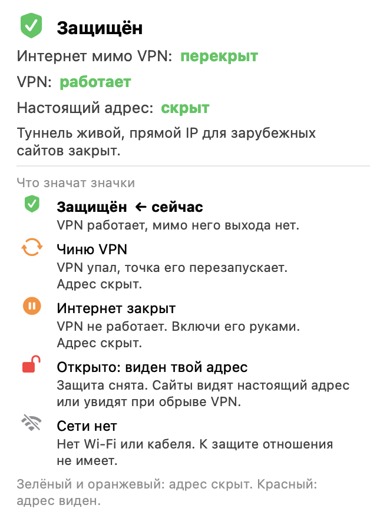
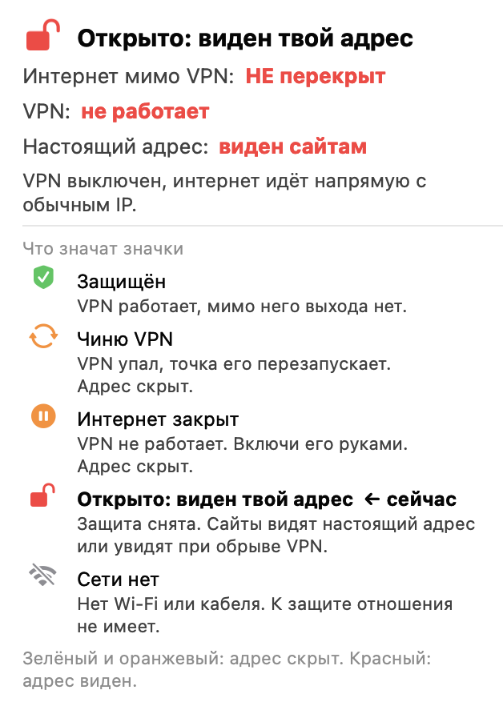

# NetDot

English · [Русский](README.ru.md)

A menu bar icon and a set of `pf` firewall rules for macOS that keep your real
IP address from showing when a VPN drops, hangs or reconnects.

While the shield is on, traffic leaves only through the VPN. If the VPN is
down, there is simply no internet, and it stays that way until **you** bring
the VPN back or open the internet by hand. Nothing reopens it automatically.

 

> **Status: a personal tool, shared as is.** It was built for one Mac running
> Happ, Red Shield and Amnezia. The interface is in Russian. It works with any
> VPN that brings up a `utun` tunnel, but the "Reconnect" menu items know only
> those three apps. Read [What has not been tested](#what-has-not-been-tested)
> before relying on it.

## Why

Most VPN clients either have no kill switch or drop it for the seconds between
"disconnect" and "connect". If a site must never see your real address, those
seconds are the problem. NetDot moves the block out of the VPN client and into
the system firewall, so it does not depend on the client being alive.

## What the icon means

| Icon | Meaning | Real address |
|---|---|---|
|  | VPN works, nothing leaves past it | hidden |
|  | VPN dropped, NetDot is restarting it | hidden |
|  | VPN is down, turn it on yourself | hidden |
|  | Shield is off | visible, or will show if the VPN drops |
|  | No network at all | — |

One rule: **green and orange mean hidden, red means visible.** Hovering the
icon opens a card with three facts (is the internet past the VPN blocked, is
the VPN up, is the address visible) and a legend of all five icons.

## How it works

- **Menu bar app** (`NetDot/main.swift`, single file, AppKit, no
  dependencies). Every 6 seconds it loads a real page through the tunnel. It
  can turn the shield on and restart the VPN; it never turns the shield off by
  itself.
- **Root helper** (`bin/install-netdot-helper`). Installed once. A launchd
  socket at `/var/run/netdot.sock` accepts exactly five words: `version`,
  `shield`, `refresh`, `on`, `off`. That is why the menu never asks for a
  password.
- **Rules** (`lib.sh`). In shield mode everything outbound on the main
  interface is blocked except an allowlist: VPN servers, the local network,
  the networks from your config, and the sites your VPN client deliberately
  routes directly. The allowlist is rebuilt every two minutes, because VPN
  servers change addresses.
- **At boot** the shield is restored before login if it was on before the
  restart.
- **A hung VPN** (connected on paper, nothing loads) is stopped and started
  again, up to ten attempts. If that fails, the icon stays on "waiting for
  you" and the internet stays blocked.

## Install

Requires macOS 13 or later and the Xcode Command Line Tools
(`xcode-select --install`).

```bash
git clone https://github.com/Branovitskiy/netdot.git
cd netdot
./install.sh
```

Then:

1. Edit `~/Library/Application Support/amnezia-manual-ks/config.env` and put in
   the address of your VPN server. Without it the VPN cannot connect once the
   shield is on.
2. Install the helper once: `sudo ~/bin/install-netdot-helper`.
3. In the icon menu choose "Переподключить …" for your VPN. This turns the
   shield on.

After editing `lib.sh`, repeat step 2: the helper runs its own copy. After
editing `main.swift`, run
`~/Library/Application Support/amnezia-manual-ks/NetDot/build.sh`.

To stop macOS from asking for the app's permissions after every rebuild, put a
file `sign-identity.txt` next to `config.env` with one line: the name of your
code signing certificate (`security find-identity -v -p codesigning`).

## If the internet is gone

NetDot keeps a journal in
`~/Library/Application Support/amnezia-manual-ks/netdot.log`: one line per
change, one per minute while all is well, every check while something is
wrong. Each line says where traffic is routed, the Wi-Fi address, whether the
VPN is up, whether the VPN server is reachable past the tunnel, and how old the
firewall rules are. Read it first.

1. Hover the icon. The card says what is wrong.
2. Orange: turn the VPN on, or choose "Переподключить …".
3. Need the internet without the VPN right now: "Включить интернет". The icon
   turns red, your address is visible.
4. From a terminal, as a last resort: `sudo ~/bin/internet-on`.

## Lessons learned the hard way

- **One VPN at a time.** Two clients running together take traffic from each
  other, including the connection to their own server.
- **A closed window is not a disconnected VPN.** Red Shield keeps its tunnel
  in a background service.
- **Give the VLESS server as an IP, not a hostname.** A client using
  DNS-over-HTTPS cannot resolve its own server after a network change until
  the tunnel is up, and so never brings the tunnel up.
- **Probe the tunnel with a real page**, not a TCP connect: the client answers
  the connect itself even when the server is dead.
- **Two `pf` reloads at once** fail with "Resource busy", so helper commands
  are serialized with `lockf`.
- **One `start` is not enough.** Right after a network change macOS answers
  "No network available" and drops the request.

## What has not been tested

- A real reboot (by the code, the shield comes back by itself).
- The orange and red icon states on a live machine.
- `install.sh` on a clean Mac: so far everything was installed piece by piece.
- The shell scripts have not been through shellcheck.
- IPv6: everything past the VPN is blocked, IPv6 included, but the allowlist is IPv4 only, so a VPN server reachable only over IPv6 will not connect.

## Uninstall

```bash
./uninstall.sh
```

It opens the internet first, then removes the icon, the helper and the rules.
Your settings in `~/Library/Application Support/amnezia-manual-ks` are kept.

## Pictures

Every picture in `docs/` is drawn by the app itself, without touching the VPN:

```bash
~/Applications/NetDot.app/Contents/MacOS/NetDot --snapshot docs
```

## License

[MIT](LICENSE)
